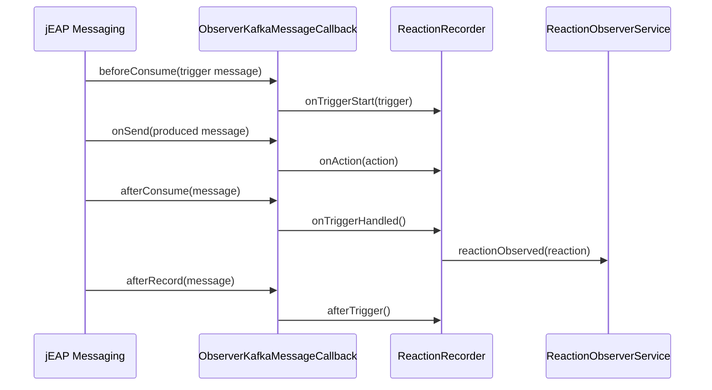

# How it works

The Reaction Observer records, per consumed message, how the service responds to it. The vocabulary is:

- **Observation** — a single message seen on Kafka, described by its `type` (`EVENT` or `COMMAND`),
  its fully-qualified name (message type, plus the variant if any) and a small set of properties
  (currently the `topic`). Each observation has a deterministic id derived from these values.
  With reaction model version 2 an outgoing HTTP request is an observation, too (`HTTP_REQUEST`), see
  [HTTP requests as actions](http-requests.md).
- **Trigger** — the observation of a *consumed* message that begins a reaction, or with reaction model
  version 2 of an incoming HTTP request, see [HTTP requests as triggers](http-triggers.md).
- **Action** — the observation of a message *produced* while handling a trigger, or with reaction model
  version 2 of an outgoing HTTP request.
- **Reaction** — a trigger together with the (de-duplicated, ordered) set of actions produced in
  response. A reaction has a stable `id` built from the trigger and action ids, so the same
  behavioural pattern always yields the same id.

## Recording flow

The observer plugs into jEAP Messaging through `ObserverKafkaMessageCallback`, a
`JeapKafkaMessageCallback`. Recording is per-thread (`ThreadLocal`) so concurrent consumers do not
interfere:

A message produced *outside* any trigger (e.g. by a scheduler) is recorded as an **action-only**
reaction. A trigger with no resulting actions is a **trigger-only** reaction.

The observer's own events (`ReactionIdentifiedEvent`, `ReactionsObservedEvent`) and
`MessageProcessingFailedEvent` are filtered out, so they are never observed as reactions.

## What gets published

`ReactionObserverService` does two things with each observed reaction:

1. **Identify** — the first time a reaction id is seen in an identification period (see
   [Reidentification](#reidentification)), a `ReactionIdentifiedEvent` is published to the
   `reaction-identified-topic`, carrying the full trigger/action structure of the new pattern. A single
   thread of the observer publishes these events one after the other, so a slow or unreachable Kafka
   broker does not delay the observed code. If the publication fails, the reaction is identified again the
   next time it occurs.
2. **Count** — every execution of a reaction the instance has marked as identified increments an in-memory
   counter keyed by reaction id. The instance marks a reaction when it sees it for the first time in the
   period, before it hands the identification over for publication. It removes the mark if the hand-over is
   rejected or if the publication fails later, and identifies the reaction again the next time it occurs.
   An execution of a reaction that is not marked is not counted: a Reaction Observer Service does not
   store the count of a reaction it does not know.

On a schedule, `ReactionsObservedEventScheduler` drains the counters and publishes a single
`ReactionsObservedEvent` to the `reactions-observed-topic` with the per-reaction counts for the
elapsed timeframe (the interval is `observed-event-rate-seconds`, default 300s). If no reactions were
observed in a timeframe, no event is sent. A final event is also published on graceful shutdown. Intervals
of seconds only make sense in tests and demos: in operation, choose minutes. The publication of the counts
cannot be switched off.

## Reidentification

An instance does not remember for good which reactions it has identified. When the reidentification period
is over (`jeap.reaction.observer.reidentification-period`, 24 hours by default, 7 days at most), it forgets
all of them at once, and identifies each reaction again the next time it occurs.

- An identification that never reached the Reaction Observer Service - the event was lost or could not be
  processed there - is made up for after one period at the latest. Before, the Reaction Observer Service
  skipped the counts of such a reaction until the instance restarted, unless another instance had
  identified the same reaction.
- The Reaction Observer Service keeps hearing of the reactions of an instance that runs for a long time,
  and of the reaction model version it observes them by.
- The first period of an instance lasts a random 50 to 100 percent of the period, so that the instances of
  a service that were started together do not identify their reactions again all at once.
- Each identification is a message of its own: the idempotence id of the `ReactionIdentifiedEvent` ends
  with the identification start, the start of the period. No two periods of an instance start within the
  same second, which is why the period is at least 2 seconds.
- Periods of seconds or minutes only make sense in tests and demos. In operation, a period of one or several
  days is appropriate. If the period is shorter than the time it takes to report all reactions of the
  instance, the queue of pending identifications stays full, and executions are dropped as `not_identified`.
- The load is one small event per reaction, instance and period at most.
- The reidentification is always active, whatever the reaction model version, and needs no particular
  version of the Reaction Observer Service.

## Best-effort and bounded by design

- Exceptions during recording are caught and logged, never propagated to business logic.
- The observed code never waits for the publication of a `ReactionIdentifiedEvent` (see above). On
  graceful shutdown, pending identifications get a few seconds to complete; an abandoned one is
  identified by a later run of the service instance when the reaction occurs there.
- Counting goes by the mark of the instance, not by what has reached the Reaction Observer Service. An
  execution that is counted stays counted if the identification of its reaction fails afterwards. That
  includes an execution another thread observes in the moment between the mark and the hand-over of the
  identification, if the hand-over is then rejected. A `ReactionsObservedEvent` can therefore count a
  reaction whose identification is still pending or has failed, most likely the final event on shutdown
  or while the broker is slow. The Reaction Observer Service stores the counts of the reactions it knows,
  also from an earlier period or from another instance, and skips the others.
- An execution that is observed while the scheduler fetches the counts is counted exactly once: either in
  the counts that are fetched, or in the counts that follow them. Fetching the counts waits for the
  executions that are just being counted, and makes the observed code wait for the blink of an eye it
  takes. The counts that follow are published with the next `ReactionsObservedEvent`; what is counted after
  the final event on shutdown is not published any more.
- An instance identifies at most `4096` distinct reactions per identification period, capping memory use.
  The executions of any further reaction are neither identified nor counted until the period is over; a
  warning is logged once per period, and the [metrics](#metrics) show both that the limit is reached and
  how many executions were not counted. The limit starts anew with each period.
- The execution that finds the identification of its reaction rejected at the hand-over for publication
  is not counted (`not_identified`): the service is shutting down, or the queue of pending identifications
  is full. The queue holds 4096 identifications, as many as a period has; it can only be full if a period
  starts while the identifications of the period before are still waiting, for example because the broker
  is unreachable. The reaction is identified again the next time it occurs.
- The counts that wait to be published are those of at most `4096` distinct reactions as well, so a
  `ReactionsObservedEvent` has at most 4096 entries. Once the counts are full, the executions of further
  reactions are not counted until the scheduler fetches the counts for the next `ReactionsObservedEvent`
  (`count_limit`), and they are not made up for later; a reaction that is counted already is always
  counted. See
  [below](#more-than-4096-distinct-reactions) for when that happens.
- At most `100` message actions per trigger are tracked; once the limit is reached a one-time warning is
  logged and further actions are ignored. HTTP request actions have a budget of their own of `100` per
  trigger.

### More than 4096 distinct reactions

The observer is made for service instances with at most 4096 distinct reactions. Such an instance loses no
execution to a limit. An instance that observes more distinct reactions cannot observe and count all of
them reliably, as a matter of principle:

- Within an identification period, the executions of every reaction beyond the first 4096 are neither
  identified nor counted (`reaction_limit`).
- The counts that wait to be published can be full although no period has reached its limit: when a
  period ends between two `ReactionsObservedEvent`s, the counts take the reactions of both periods. For
  example, with 3000 reactions counted before the end of the period and 3000 other ones observed after
  it, the counts have room for 1096 of the new reactions. The remaining 1904 are identified as well, but
  their executions are dropped (`count_limit`) until the scheduler fetches the counts for the next
  `ReactionsObservedEvent`, which it does before it tries to send the event. The same goes for a
  reidentification period shorter than the interval of the `ReactionsObservedEvent`.

The observer keeps these cases simple on purpose. It drops what does not fit, never a count it already
has, and shows every dropped execution in the [metrics](#metrics). It makes no further effort - splitting
the counts over several events, for example - for an accuracy that is not given beyond the limit anyway.
If the metrics show `reaction_limit` or `count_limit`, the counts of the instance are incomplete.

### Size of the event with the counts

A `ReactionsObservedEvent` carries the full id of each counted reaction. Kafka limits the size of a record,
to 1 MiB by default, which leaves about 250 bytes per entry for an event with 4096 entries, the id
included. The ids of reactions triggered by messages are usually shorter than that, but an id embeds the name of
its trigger, and the name of an HTTP request trigger can be long. If an instance counts thousands of
reactions with very long ids in one interval, the event can exceed the limit. Kafka rejects it then, and
the counts of that interval are lost.

## Metrics

If the service has a `MeterRegistry`, the observer publishes two metrics, both visible from the start of
the service.

| Metric (Prometheus name) | `reason` | Shows |
|---|---|---|
| `jeap_reaction_observer_identified_reactions` | - | Gauge: the number of reactions the instance has identified in the current identification period, `4096` at most. It is `0` again when a period is over |
| `jeap_reaction_observer_dropped_executions_total` | `reaction_limit`, `not_identified`, `count_limit` | Loss: every execution the observer dropped for one of the three reasons below, exactly once. Other losses are not part of it |

- `reaction_limit`: the instance has already identified 4096 reactions in the current period, and the
  reaction is not one of them.
- `not_identified`: the executions the observer dropped itself because the identification of the reaction
  could not be handed over for publication, or had already failed when the execution was to be counted.
  An execution another thread observed in the meantime can have been counted all the same (see above),
  and the metric does not show the counts the Reaction Observer Service skips.
- `count_limit`: the counts that wait to be published already are those of 4096 reactions, and the reaction
  is not one of them (see above).
- The metric counts nothing else: the counts of a `ReactionsObservedEvent` that could not be sent do not
  show in it.
- A service can replace the metrics of the library with a `ReactionObserverMetrics` bean of its own. The
  interface is an internal one all the same, no stable API, and can change in any release.
- The observation of HTTP requests has metrics of its own, see
  [HTTP requests as actions](http-requests.md#metrics).

## Related

- [Getting started](getting-started.md)
- [HTTP requests as actions](http-requests.md)
- [HTTP requests as triggers](http-triggers.md)
- [Configuration reference](configuration.md)
- [System behaviour documentation](system-behaviour-documentation.md)
